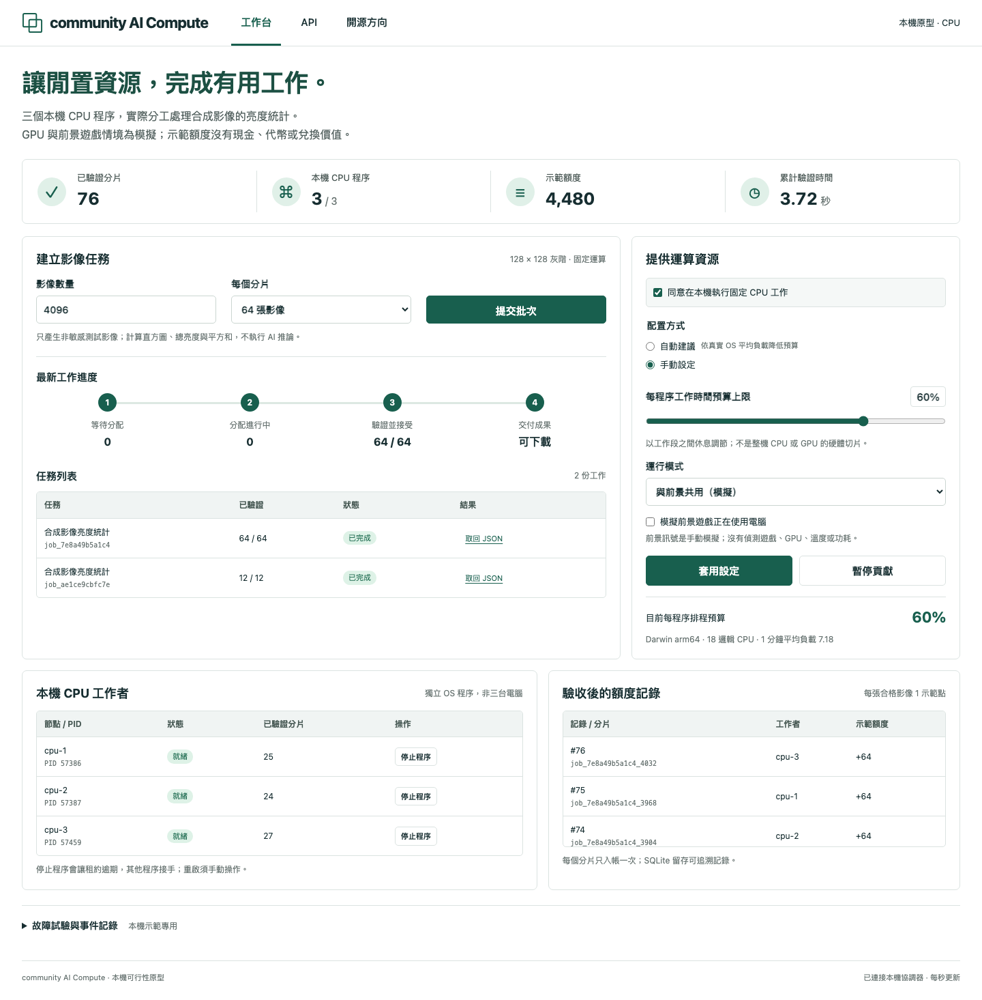

# Community AI Compute

**Shared compute for broader access to AI. Built openly, for the benefit of humanity.**

[繁體中文](README.zh-Hant.md) · [Join the discussion](https://github.com/Andylaw95/community-ai-compute/discussions) · [Try the demo](#try-the-working-example) · [Contribute](CONTRIBUTING.md)

Community AI Compute explores whether people can voluntarily contribute spare computing capacity to useful AI work while staying in control of their own devices. The goal is to make compute more accessible to students, researchers, independent developers, and public-interest projects.

The intended experience: opt in, choose when and how much to contribute, receive suitable work automatically, and pause or leave at any time. Work must be verified before contribution credit is recorded. Fair compensation and shareable compute credits are longer-term design questions.

**Current stage: a working local coordination prototype, research, and open design questions.** The demo processes synthetic image statistics on three CPU processes on one computer. It does **not** run an AI model, use a GPU, or connect remote volunteers. We are opening the project early so others can help decide what comes next.

## Try the working example

Use Python 3.12 on macOS or Linux. No third-party packages, model downloads, accounts, or paid APIs are needed. Windows support has not been implemented or verified.

```bash
git clone https://github.com/Andylaw95/community-ai-compute.git
cd community-ai-compute
python3 -m examples.quickstart
```

This command opts in to a small synthetic CPU job. It starts a temporary loopback server and three workers, submits 96 images, verifies completion and duplicate handling, prints JSON, then cleans up the workers and database.

Expected fields include:

```json
{
  "status": "completed",
  "worker_processes": 3,
  "accepted_images": 96,
  "accepted_chunks": 6,
  "demo_credits_without_monetary_value": 96,
  "duplicate_submission_reused_job": true,
  "conflicting_submission_http_status": 409,
  "all_worker_processes_stopped": true,
  "temporary_database_removed": true
}
```

For the interactive Traditional Chinese dashboard:

```bash
python3 -m prototype.run --port 8765
```

Open **http://127.0.0.1:8765**, give contribution consent, apply settings, and submit a batch. **Ctrl+C in the terminal** stops the server and workers; closing the browser alone does not. Keep the service local; do not forward its port to the Internet.

[Detailed walkthrough and HTTP example](docs/QUICKSTART.md)

<details>
<summary>See the working local dashboard</summary>



Screenshot from the separate browser verification run (4,480 synthetic images across two jobs), not the 96-image quickstart or a GPU network.
</details>

## What exists today

| Implemented and locally tested | Still to investigate or build |
| --- | --- |
| Jobs, chunks, HTTP leases, three OS processes | Real AI workloads, multiple computers, GPUs |
| Full result recomputation, bounded retries, crash recovery | Affordable verification on untrusted or colluding devices |
| SQLite ledger, one credit entry per accepted chunk, replay handling | Production accounting, payments, redeemable credits, tokens |
| Consent, pause/resume, cooperative CPU duty cycle | Real idle/game detection, enforceable GPU limits, power controls |
| Local Host/Origin checks and fixed synthetic workload | Public-network authentication, isolation, privacy guarantees |

Fresh launch verification passed **15 functional tests** on macOS with Python 3.12.1. In these small trials, verification by full recomputation cost about as much as the original computation. That is a problem to solve, not evidence of economic viability. See the [validation report](docs/VALIDATION.md) and [evidence](evidence/community-launch-verification.json).

The foreground-game switch is a simulation. Budget percentages are cooperative time budgets per worker, not a guaranteed share of the computer or GPU. Demo credits have no monetary or redeemable value.

## Help shape the next step

Technical criticism, reproduction reports, translations, and real use cases are welcome. You do not need an expensive GPU to participate.

1. **Choose one useful workload.** What non-sensitive batch task helps a real person or public-interest project? What permissions, quality threshold, and deadline apply?
2. **Make verification practical.** How should we compare results, measure error rates, and account for verification and retries?
3. **Protect participants.** What must be true before work leaves one trusted computer? How do we protect devices, data, and the ability to stop?
4. **Learn from existing work.** Should this become an integration, a small missing component, or a separate project?

Start in [Discussions](https://github.com/Andylaw95/community-ai-compute/discussions), reproduce the example, or pick a [good first issue](https://github.com/Andylaw95/community-ai-compute/issues?q=is%3Aissue%20is%3Aopen%20label%3A%22good%20first%20issue%22). Explain the evidence and tradeoffs behind suggestions.

## Project guide

- [Community and decisions](COMMUNITY.md)
- [Contributing](CONTRIBUTING.md) and [code of conduct](CODE_OF_CONDUCT.md)
- [Architecture and trust boundaries](docs/ARCHITECTURE.md)
- [Research and reuse questions](docs/RESEARCH.md)
- [Roadmap](ROADMAP.md) and [security reporting](SECURITY.md)

This is an early, AI-assisted prototype. No external partners, customers, nonprofit status, cost advantage, energy savings, or production readiness are claimed. The public-benefit mission guides our questions; its impact must be demonstrated.

## License

Project code and original documentation use [Apache-2.0](LICENSE). Referenced papers, models, datasets, and other projects retain their own licenses; linking does not grant redistribution rights.
