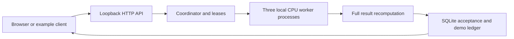

# Architecture and trust boundaries

The implementation today, on one trusted computer:

`prototype/server.py` exposes the API and manages workers. `engine.py` owns jobs, chunks, attempts, leases, policy, and the ledger. `worker.py` executes chunks. `compute.py` defines the only workload. `run.py` manages startup/shutdown. `examples/quickstart.py` demonstrates an HTTP client with temporary storage.

Jobs use idempotency keys and canonical payload digests. Each chunk can have several attempts; lease expiry allows a bounded retry. SQLite uniqueness and a transaction protect acceptance and credit recording. Execution may repeat; acceptance/accounting are intended to happen once. Normal pause/release does not exhaust the three-failure retry allowance.

The coordinator trusts its local environment. Workers receive an ephemeral internal credential at startup. This is not a remote identity protocol or proof of a trustworthy volunteer host. Host/Origin checks, bounded requests, and the fixed workload reduce the local API surface; they do not provide a sandbox for arbitrary code.

## Limits that matter next

- Worker and verifier use the same function. A shared bug can pass both; independent fixtures are needed.
- Verification holds the coordinator lock and database transaction. Larger work could block heartbeats. Moving it outside the lock requires an atomic final recheck of attempt ownership, lease validity, and previous acceptance.
- CPU rest periods are cooperative. They do not isolate GPU capacity or limit verifier CPU usage.
- Three processes on one device do not test WAN scheduling, NAT, heterogeneous GPUs, or untrusted hosts.
- Transport encryption, isolation, correctness, and confidentiality from device owners are separate concerns. Ordinary host execution does not hide plaintext data or models from that host.

## Proposed next experiment

Choose one useful non-sensitive workload, a permitted model/dataset, and measurable acceptance criteria. Then design a bounded two-trusted-machine experiment with identity, transport, cancellation, retries, resource use, and cleanup. The current code has no public listener or remote worker registration.
